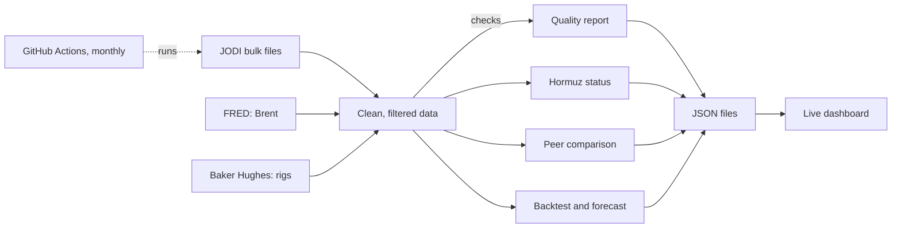

# Nigeria Oil Value Chain Pipeline

[](https://github.com/Gospelgit/wa-oil-pipeline/actions/workflows/pipeline.yml)

An automated data pipeline that tracks Nigeria's crude oil and refined fuel against 12 other producers, grouped by region, and forecasts crude production 12 months ahead. It pulls monthly data from JODI, FRED and Baker Hughes, checks it, and publishes JSON files for a live dashboard. It runs itself every month on GitHub Actions and skips the run when no source has published anything new.

## Key findings

- **Nigeria became a net exporter of refined fuel in 2026.** It imported 480 thousand barrels a day (kb/d) more fuel than it exported in 2023. By 2026 it exported 133 kb/d more than it imported, with the switch in March 2026. Four separate JODI series agree: crude imports, refinery intake, refinery output and product trade.
- **Nigeria's crude output is the least stable of the 13.** It typically moves about 4% from one month to the next, against 0% to 3% elsewhere. Production is 1,500 kb/d, 55% of its 2013 peak. Only Venezuela is further below its own peak.
- **Nigeria's wells are not the problem.** Each Nigerian oil rig supports about 110 kb/d of output, close to Norway (120) and far above the US (31). The gap with its peak points to losses and outages, not geology.
- **Oil prices and rig counts don't improve 12-month forecasts.** A model using lagged Brent and rigs came last in testing. A country's recent level is the best guide over this horizon.
- **The 2026 Strait of Hormuz closure shows up clearly in the data.** Kuwait, which has no pipeline around the strait, saw crude exports fall to 2% of their pre-war level in May 2026, and they were back to 77% by September. Saudi Arabia fell only to 49%, because it rerouted oil through its East-West pipeline to the Red Sea. The pipeline tracks the strait's status from Kuwait's exports and flags the Kuwaiti and Saudi forecasts while it is restricted.

## How it works



1. **Ingestion.** `fetch_jodi.py` downloads JODI's two bulk files (all countries, all series, about 300 MB unzipped). It reads them in chunks and keeps only the 13 countries and 17 series used here. `fetch_brent.py` gets the Brent price. `fetch_rigs.py` reads the oil rig counts from the Baker Hughes report uploaded to `data/manual/rigs/` (their site blocks automated downloads).
2. **Quality checks.** `checks.py` stops the run if a country goes missing, the data is stale, any value is negative, or too much history disappears. It records revisions, countries that have stopped reporting, and unusual month-to-month jumps.
3. **Hormuz status.** `hormuz.py` reads the strait's status from Kuwait's exports against their pre-war level (Saudi Arabia shown as context), with a manual override in `config/hormuz_status.json`.
4. **Peer comparison.** `peers.py` builds the Nigeria against peers table.
5. **Forecasting.** `backtest.py` tests five models on hidden months, and `forecast.py` forecasts 12 months ahead with ranges based on real errors.
6. **Publishing.** `export_json.py` writes the files in `public_data/` that the dashboard reads.

Design decisions and the full test results are in [docs/METHODOLOGY.md](docs/METHODOLOGY.md).

## The data

| Source | What | Countries |
| --- | --- | --- |
| [JODI-Oil World Database](https://www.jodidata.org/oil/) | Crude production, imports, exports, refinery intake, stocks; petrol, diesel and total products: refinery output, demand, imports, exports | 13 (products: 12, no Canada) |
| [FRED, MCOILBRENTEU](https://fred.stlouisfed.org/series/MCOILBRENTEU) | Brent spot price, monthly | |
| [Baker Hughes Worldwide Rig Count](https://bakerhughesrigcount.gcs-web.com/intl-rig-count) | Active oil rigs, monthly, from 2013 | 11 (no Russia or Iran) |

**Countries by region:** Africa: Nigeria, Algeria, Angola, Libya. Middle East: Saudi Arabia, Kuwait, Iran. Europe: Norway, Russia. North America: United States, Canada. South America: Brazil, Venezuela.

**Gaps:** Iran stopped reporting to JODI after July 2018, Russia after March 2023 and Angola after November 2023. Libya has no data from April 2014 to May 2026. These are shown as gaps and never filled in.

## Running the pipeline

### On GitHub

The pipeline runs by itself on the 22nd of every month, after JODI's update around the 20th. To run it by hand, go to **Actions → Monthly pipeline run → Run workflow**, tick **"force"**, then click **Run workflow**. Without force, the run skips if no source has changed.

### Updating the rig counts (monthly, about 1 minute)

Baker Hughes' site blocks automated downloads, so the rig report is uploaded by hand. Early each month, go to the [international rig count page](https://bakerhughesrigcount.gcs-web.com/intl-rig-count) and download **Worldwide Rig Count Report - New Report**. Then, on GitHub, open `data/manual/rigs/`, click **Add file → Upload files**, drop the file in and commit. The upload starts a pipeline run straight away. If the rig data falls more than 2 months behind, the dashboard shows a reminder.

### Updating the Strait of Hormuz status by hand

JODI data runs about two months behind the news. To set the status yourself, edit `config/hormuz_status.json` on GitHub and replace `"override": null` with, for example:

```json
"override": {"status": "open", "as_of": "2026-12-01", "note": "Agreement in force", "source": "https://..."}
```

Status can be `closed`, `restricted` or `open`. Set it back to `null` once the data has caught up.

### Locally

Requires Python 3.13. Commands are for Windows PowerShell, from the project root.

```powershell
python -m venv .venv
.venv\Scripts\Activate.ps1
pip install -r requirements.txt

python ingestion\fetch_jodi.py
python ingestion\fetch_brent.py
python ingestion\fetch_rigs.py
python transform\checks.py
python transform\hormuz.py
python transform\peers.py
python ml\backtest.py
python ml\forecast.py
python publish\export_json.py
```

## Project structure

```
ingestion/   fetch_jodi.py, fetch_brent.py, fetch_rigs.py, check_updates.py
transform/   checks.py, hormuz.py, peers.py
ml/          data.py, models.py, backtest.py, forecast.py
publish/     export_json.py
pipeline/    config.py (countries, codes, URLs), http_utils.py (downloads with retries)
config/      hormuz_status.json (manual override)
data/        reference (hand exports used to validate), clean, backtest, forecast
public_data/ JSON files for the dashboard
```

## Author

Gospel Bassey · [gospelbassey.com](https://gospelbassey.com) · [LinkedIn](https://www.linkedin.com/in/gospel-bassey-31a225143)
